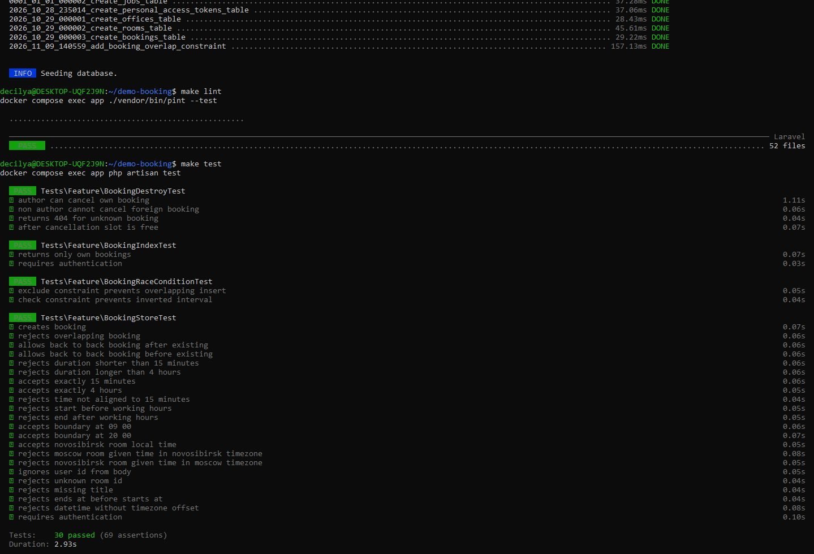

# demo-booking

## 📦 Решение

| | |
|---|---|
| **Форк** | https://github.com/decilya/demo-booking |
| **Ветка с решением** | [`fix/booking-rules`](https://github.com/decilya/demo-booking/tree/fix/booking-rules) |
| **Сравнение с исходником** | [master…fix/booking-rules](https://github.com/rcsi-science/demo-booking/compare/master...decilya:fix/booking-rules) |
| **REVIEW.md** | [аудит исходного кода](REVIEW.md) |
| **AI_NOTES.md** | [заметки об использовании ИИ](AI_NOTES.md) |

### Ключевые файлы решения

| Файл | Что делает |
|---|---|
| [`app/Http/Requests/StoreBookingRequest.php`](app/Http/Requests/StoreBookingRequest.php) | Валидация: формат ISO 8601, `after:starts_at`, TZ офиса, длительность 15–240 мин, шаг 15 мин, отсутствие пересечений |
| [`app/Rules/NoOverlappingBooking.php`](app/Rules/NoOverlappingBooking.php) | Rule для строгого непересечения (`<` / `>` — встречи «впритык» разрешены) |
| [`app/Rules/WithinOfficeWorkingHours.php`](app/Rules/WithinOfficeWorkingHours.php) | Rule для рабочего времени 09:00–20:00 в TZ офиса |
| [`app/Rules/BookingDurationInRange.php`](app/Rules/BookingDurationInRange.php) | Rule для длительности 15–240 минут |
| [`app/Rules/AlignedToBookingStep.php`](app/Rules/AlignedToBookingStep.php) | Rule для шага 15 минут |
| [`app/Actions/CreateBookingAction.php`](app/Actions/CreateBookingAction.php) | Бизнес-логика создания: `user_id = auth()->id()`, обработка `SQLSTATE 23P01` → `409`, `SQLSTATE 23514` → `422` |
| [`app/Policies/BookingPolicy.php`](app/Policies/BookingPolicy.php) | Авторизация отмены (только автор) |
| [`app/Http/Resources/BookingResource.php`](app/Http/Resources/BookingResource.php) | Контракт ответа API |
| [`app/Exceptions/BookingConflictException.php`](app/Exceptions/BookingConflictException.php) | Исключение для `409` |
| [`app/Http/Controllers/BookingController.php`](app/Http/Controllers/BookingController.php) | Тонкий контроллер: `store` через `Action`, `destroy` через `Policy` |
| [`database/migrations/`](database/migrations/) | Миграция: `btree_gist` + `timestamptz` + `CHECK` + `EXCLUDE` |
| [`tests/Feature/`](tests/Feature/) | Feature-тесты на все правила + race condition |

### Что сделано (кратко)

- **Critical-уязвимости** (SQLi, IDOR, mass assignment) — устранены.
- **Бизнес-правила** ТЗ (пересечения «впритык», длительность, шаг, TZ офиса, автор отмены) — реализованы в `FormRequest` + `Action`.
- **Race condition** — решён на уровне схемы БД (`EXCLUDE`-констрейнт), см. раздел ниже.
- **Тесты** — покрывают все правила, оба часовых пояса, mass assignment, IDOR, race condition.

---

## 🔒 Решение race condition

**Проблема.** В исходном коде проверка пересечения и `INSERT` не атомарны
(TOCTOU). Два параллельных запроса проходят проверку одновременно и создают
пересекающиеся брони.

**Решение.** Инвариант «нет двух пересекающихся броней на комнату» выражен
на уровне схемы БД через `EXCLUDE`-констрейнт PostgreSQL:

```sql
CREATE EXTENSION IF NOT EXISTS btree_gist;

ALTER TABLE bookings
  ALTER COLUMN starts_at TYPE timestamptz USING starts_at AT TIME ZONE 'UTC',
  ALTER COLUMN ends_at   TYPE timestamptz USING ends_at   AT TIME ZONE 'UTC';

ALTER TABLE bookings
  ADD CONSTRAINT bookings_valid_interval CHECK (ends_at > starts_at);

ALTER TABLE bookings
  ADD CONSTRAINT bookings_no_overlap
  EXCLUDE USING gist (
    room_id WITH =,
    tstzrange(starts_at, ends_at) WITH &&
  );
```

**Почему не `lockForUpdate`.**
- Сериализует **всю комнату**, а не только пересекающиеся интервалы — бронь
  на 10:00 ждёт бронь на 15:00, хотя они не пересекаются.
- Держит блокировку всю транзакцию — медленные операции внутри транзакции
  блокируют всех.
- Защищает только тот код, который **знает** о блокировке: админка, миграции
  данных, psql-сессия — обойдут.
- Не тестируется без реальной конкурентности.

`EXCLUDE` — **декларативный инвариант в данных**, а не императивный мьютекс
в коде. Работает на любом уровне доступа к БД. Проверяется одним `INSERT`-запросом
в тесте.

**Обработка в приложении (три слоя):**

1. **`StoreBookingRequest`** — soft-check через Eloquent. 99% конфликтов
   ловятся здесь → `422` с указанием поля и понятным сообщением.
2. **`EXCLUDE`-констрейнт** — hard-check. Ловит race window между проверкой
   и `INSERT`. `SQLSTATE 23P01` → `CreateBookingAction` транслирует в
   `BookingConflictException` → `409 Conflict`.
3. **`CHECK (ends_at > starts_at)`** — третий рубеж. Инвертированный интервал
   — это empty `tstzrange`, который **не пересекается ни с чем** (`empty && anything = false`),
   поэтому `EXCLUDE` его **пропустит**. `CHECK` ловит `SQLSTATE 23514` → `422`
   + `Log::error` (это баг валидации, а не race condition).

**Тест race condition** (`tests/Feature/BookingRaceConditionTest.php`):
прямой `INSERT` в обход `FormRequest` → `QueryException` с `SQLSTATE 23P01`;
счётчик броней не увеличился. Воспроизводимо, без параллельных процессов.

---

## 🚀 Запуск

Нужны Docker и Docker Compose.

```bash
docker compose up -d --wait
docker compose exec app php artisan migrate:fresh --seed
```

API доступно по адресу http://localhost:8000/api.

**Требования:**
- Пользователь PostgreSQL должен иметь право на `CREATE EXTENSION btree_gist`
  (в стандартном `docker-compose` это `postgres` — сработает).
- Первый запуск занимает несколько минут: контейнер устанавливает зависимости.

---

## 🧪 Тесты

```bash
docker compose exec app php artisan test
```

Тесты идут на PostgreSQL в отдельной базе `testing`.




---

## 📋 Исходное задание

<details>
<summary>Развернуть (сохранено для сверки)</summary>

### Задание

В компании два офиса: Москва (`Europe/Moscow`) и Новосибирск (`Asia/Novosibirsk`),
в каждом есть переговорные. Предыдущий разработчик написал API бронирования,
и пользователи жалуются на ошибки.

#### Часть 1. Ревью
Составьте `REVIEW.md`: перечислите проблемы, для каждой — серьёзность
(critical / major / minor) и как исправить. Если место выглядит подозрительно,
но проблемой не является, — тоже напишите об этом.

#### Часть 2. Доработка
Исправьте `store` и `destroy` так, чтобы выполнялись правила:
- Брони одной комнаты не пересекаются. Встречи «впритык» разрешены.
- Длительность от 15 минут до 4 часов, шаг 15 минут.
- Бронь целиком укладывается в рабочее время 09:00–20:00 по местному времени
  офиса. Клиент присылает время в ISO 8601 с любым смещением.
- Отменить бронь может только её автор.
- Понятные ошибки валидации (422).
- Других ограничений на даты нет.

Feature-тесты на все правила. `index` и `today` исправлять не нужно.

**Бонус:** при двух одновременных запросах на один слот может создаться
двойная бронь. В основной части достаточно, чтобы брони не пересекались при
последовательных запросах. Гонку исправьте или опишите в README, как бы вы
это сделали.

#### Часть 3. AI_NOTES.md
Ответы на вопросы о работе с ИИ.

### Данные сидера

| Офис | TZ | Комнаты (id) |
|---|---|---|
| Москва | `Europe/Moscow` | Арбат (1), Тверская (2), Остоженка (3) |
| Новосибирск | `Asia/Novosibirsk` | Обь (4), Академгородок (5) |

| Пользователь | id | Токен |
|---|---|---|
| Анна | 1 | `anna-token` |
| Борис | 2 | `boris-token` |

### API

Все методы требуют `Authorization: Bearer <токен>` и `Accept: application/json`.
Без `Accept` запрос без токена вернёт 500 вместо 401.

| Метод | Адрес | Что делает |
|---|---|---|
| GET | `/api/bookings` | Мои брони |
| POST | `/api/bookings` | Создать бронь |
| DELETE | `/api/bookings/{id}` | Отменить бронь |
| GET | `/api/rooms/{room}/bookings/today` | Брони комнаты на сегодня |

Пример:

```bash
curl -X POST http://localhost:8000/api/bookings \
  -H "Authorization: Bearer anna-token" \
  -H "Accept: application/json" \
  -H "Content-Type: application/json" \
  -d '{"room_id": 1, "user_id": 1, "title": "Планёрка",
       "starts_at": "2026-11-02T10:00:00+03:00",
       "ends_at": "2026-11-02T11:00:00+03:00"}'
```

Лог созданных броней пишется в `storage/logs/bookings.log`.

</details>
